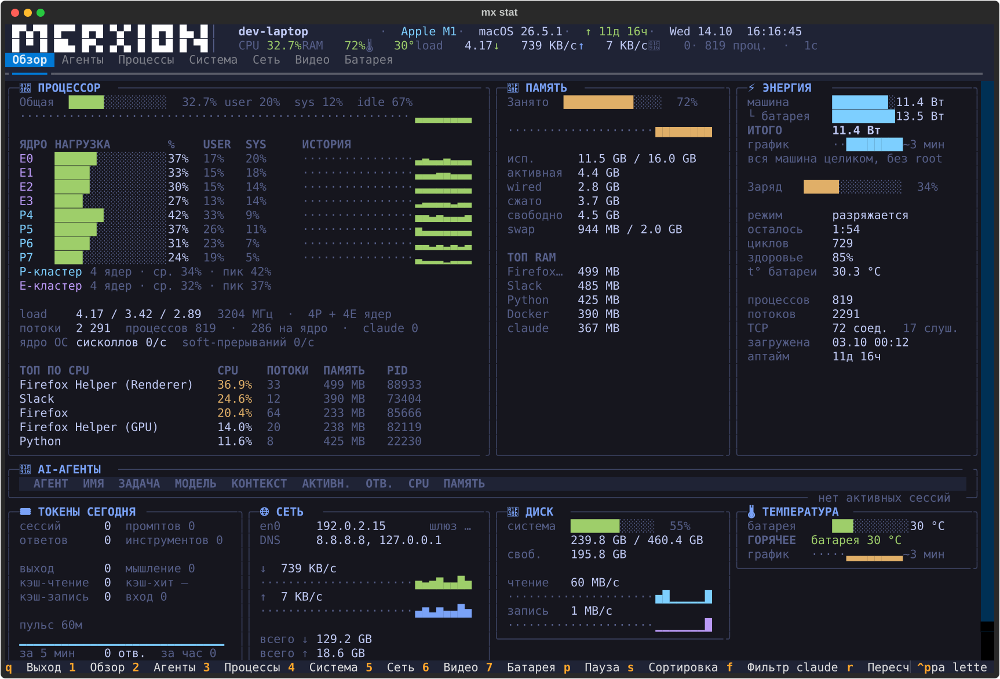

# mx-stat — system & AI agent monitor

[Русская версия](README.ru.md) · AGPL-3.0 · Linux · macOS · Python 3.11+

A full-screen terminal monitor (Textual, tokyo-night theme). Beyond the usual `htop` view
it shows **live coding-agent sessions**: what each one is working on, which model, how much
context is consumed, when it last wrote, a per-minute response pulse and an hourly histogram.

Agents are discovered per provider; how much detail is available depends on what each one
writes to disk:

| Provider | Detected | Task, model, context, tokens |
|---|---|---|
| Claude Code | ✅ | ✅ full, plus branch, permission mode and daily token stats |
| Codex | ✅ | ✅ full, plus daily token stats and real busy/idle from turn events |
| opencode | ✅ | ✅ task, model, session tokens (no context window, no daily breakdown) |
| muse, crush, qwen, aider, gemini | ✅ process only | — no on-disk session state to read |

Adding a provider is one function in `share/core.py` — see `_codex_agents` /
`_opencode_agents` for the shape.

```
█▀▄▀█ █▀▀ █▀█ ▀▄▀ █ █▀█ █▄ █  │ Intel Core i7 · Ubuntu 24.04 · ↑ 9d 21h · Tue 08.09  11:42:21
█ ▀ █ ██▄ █▀▄ ▄▀▄ █ █▄█ █ ▀█  │ CPU 24.3%  RAM 68%  load 2.49  ↓ 10 KB/s  ↑ 220 KB/s  🤖 5 busy 3 · 1s  ·  Stat
```



> **Note:** the interface is currently in Russian. Documentation is bilingual; UI
> localisation is not done yet — contributions welcome.

## Install

```sh
git clone https://github.com/merxion-io/mx-stat.git && cd mx-stat
./install.sh
mx stat            # TUI
mx stat -s         # one static snapshot (good for pipes / screenshots)
```

`install.sh` copies the code to `~/.local/share/mx-stat`, creates an isolated venv there
(via `uv` if available, otherwise `python3 -m venv`) and writes a launcher at
`~/.local/bin/mx`. Requires Python 3.11+. Paths are overridable via `MXSTAT_HOME` and
`MXSTAT_BIN`.

`mx` is a thin wrapper — right now it knows a single subcommand, `stat`.

The script runs on stock macOS bash 3.2 and BSD tools.

## Tests

There is no CI; run the checks locally with the installed venv and the source tree:

```sh
MXSTAT_HOME=$PWD/share ~/.local/share/mx-stat/venv/bin/python tests/battery_test.py       # battery parsing, no hardware needed
MXSTAT_HOME=$PWD/share ~/.local/share/mx-stat/venv/bin/python tests/smoke_test.py 140 46  # headless: clicks through every tab
```

Add `--show` to the smoke test to print a text dump of each tab (it shows your own machine's data).
Both exit with code 0 on success.

## What's inside

| Tab | Contents |
|---|---|
| **1 Overview** | CPU as a table (cores as columns, USER/SYS, per-core history, P/E clusters, threads, syscalls, top processes), memory with top RAM consumers, power/battery, agent table, today's tokens with a pulse, network, disk |
| **2 Agents** | Wide session table (branch, permission mode, cli/sdk type, prompts, tools, tokens), details for the selected session (task, last request, effort, last tool, cache hit), hourly output-token histogram, 7 days |
| **3 Processes** | Top 60 processes; `s` cycles sorting CPU → memory → threads → age; `f` filters to claude only |
| **4 System** | Machine, kernel, load, memory, network, battery; Claude Code card (versions, transcripts, MCP); volumes; podman/docker/OrbStack containers |
| **5 Network** | Route, DNS, VPN tunnels, TCP by state, per-interface throughput, listening ports with owning process |
| **1 Overview** — ⚡ POWER card | Live draw per node: CPU (RAPL counters), each GPU (nvidia-smi), integrated graphics (hwmon), total and a ~3 minute graph. Disks, RAM, board and PSU are not measured — no sensors exist |
| **1 Overview** — 🌡 TEMPERATURE card | Every sensor: CPU and its dies (k10temp), each GPU, integrated graphics, network chip; hottest node and a ~3 minute graph. Disk temperatures would need smartctl — not used |
| **6 GPU** | NVIDIA cards: utilisation and VRAM with history, temperature, fan, power and clocks; table of processes holding VRAM |
| **7 Battery** | Live power once a second: source (adapter / battery), big charge %, status and time to full / to empty; power flow "adapter → system / battery" (watts from the adapter, system draw, battery charge/discharge, adapter losses); voltage and current; cells with bars, spread in mV and resistance; power adapter (wattage, USB-PD voltage/current, profiles); health (cycles, capacity now / design, temperature, lifetime extremes); graphs for the last minutes. No battery — "no battery" |

Keys: `1`–`7` tabs · `p` pause · `s` sort · `f` claude filter · `r` refresh ·
`+`/`-` interval (0.5–10 s) · `q` quit.

## Where the agent data comes from

Everything is read from each agent's own files — no API, no network.

### Claude Code

- **`~/.claude/sessions/<pid>.json`** — live sessions: `sessionId`, `cwd`, `name`, `status`
  (`idle`/`busy`/`shell`), `version`, `startedAt`, `entrypoint` (`cli` / `sdk-cli`).
  The process is verified through psutil: Claude Code's process name is its version number
  (`2.1.263`), so the reliable signal is an `exe` path under `~/.local/share/claude/versions/`.
- **Transcript** `~/.claude/projects/<cwd with / and . → ->/<sessionId>.jsonl`:
  - `{"type":"ai-title","aiTitle":…}` — task name (TASK column);
  - `{"type":"last-prompt","lastPrompt":…}` — the user's last request;
  - `"role":"assistant"` lines carrying `"usage":` — tokens, model, `effort`; context =
    `input + cache_read + cache_creation` of the last response; an `[1m]` marker at the top
    of the file means a 1M limit, otherwise 200K;
  - `gitBranch`, `permissionMode`, `entrypoint` — on user/assistant lines;
  - a human prompt is `"type":"user"` plus `"origin":{"kind":"human"}`.
  Transcripts are read **incrementally** (`SessionTracker` in `core.py`) from the last
  offset, so multi-megabyte sessions cost nothing. Timestamps in the files are UTC; hourly
  and per-minute buckets are converted to local time.
- Today's and the 7-day statistics come from a regex scan of every `*.jsonl` with an mtime
  within the last 36 h / 8 days, refreshed every 20 s on a background thread.
  Codex rollouts are scanned the same way and added in, so the daily cards and the 7-day
  histogram cover both providers; the model breakdown names each one. **opencode is not
  included** — its database stores one running total per session with no per-day breakdown,
  so its tokens cannot honestly be attributed to a date.

### Codex

`~/.codex/sessions/<year>/<month>/<day>/rollout-*.jsonl` — one append-only transcript per
session, read incrementally exactly like Claude's. `turn_context` carries the model and
reasoning effort, `token_count` the live context plus `model_context_window`, and
`task_started` / `task_complete` give a genuine busy/idle status. Thread names come from
`~/.codex/session_index.jsonl`. A live process is tied to its session by the UUID in
`codex resume <uuid>`, or failing that by the newest transcript in the same working
directory that was written to during the process's lifetime.

Rollouts reach tens of megabytes, so the first pass counts responses with a byte scan and
JSON-parses only the last 4 MB: everything displayed is rewritten on every turn, so the
history is not needed.

### opencode

`~/.local/share/opencode/opencode.db`, the `session` table only — title, model, directory
and per-session token counters. That table holds dozens of rows even when the database is
hundreds of megabytes, and it is opened read-only. opencode records no context-window size,
so the accumulated input is shown in place of a context bar.

## Platforms

Everything OS-specific lives in a platform layer with one interface:
`share/platform_linux.py` and `share/platform_macos.py`, picked by `sys.platform` in exactly
one place — `share/platforms.py`. The TUI, the snapshot and all agent logic are shared;
cards adapt to the data (on a Mac the temperature card shows the battery, the core table
shows P/E clusters), not to `if darwin` branches.

## Where the system data comes from (Linux)

Read straight from the kernel; no daemons required:

- **CPU and model** — `/proc/cpuinfo`; distribution — `/etc/os-release`.
- **Power** — RAPL counters in `/sys/class/powercap`: watts are the microjoule delta between
  polls. Disks, RAM, board and PSU are not measured — no sensors.
- **Temperatures** — `/sys/class/hwmon` (CPU via k10temp), GPUs via `nvidia-smi`.
- **Battery** — cycles and health from `/sys/class/power_supply`, when the kernel exposes them;
  tab 7 takes voltage, current, power, capacity, status and the adapter from there too (the
  kernel exposes neither cells nor the "adapter → system" flow).
- **Network** — default route via `ip -4 route show default`, DNS from `/etc/resolv.conf`,
  Wi-Fi via `nmcli`, TCP sockets and listening ports via `psutil`.
- **Containers** — `podman ps`, falling back to `docker ps`; with neither installed the card
  is simply hidden.
- **GPUs** — `nvidia-smi` (utilisation, VRAM, temperature, clocks, processes). Without an
  NVIDIA card tab 6 is empty.

## Where the system data comes from (macOS)

Stock tools only, no root and no extra packages:

- **CPU, model, kernel** — `sysctl` (`machdep.cpu.brand_string`, `hw.model`, `kern.version`,
  `hw.perflevel0/1.logicalcpu`); host name from `scutil --get ComputerName`.
- **P/E clusters** — `cluster-type` of each core from the device tree
  (`ioreg -p IODeviceTree`). On Apple Silicon the efficiency cores come first (on an M1
  cpu0–3 are E), so "the first N are performance cores" would be wrong.
- **Memory** — psutil plus `vm_stat` for memory held by the compressor; wired is shown
  instead of the Linux page cache.
- **Disks** — only `/System/Volumes/Data` and `/Volumes/*`: the system volume is mounted twice
  (read-only snapshot at `/` and the writable Data volume) and only Data shows real usage.
- **Battery, power, temperature** — `ioreg -rn AppleSmartBattery`: cycles, health
  (`AppleRawMaxCapacity / DesignCapacity`), battery temperature, and whole-machine draw from
  `PowerTelemetryData.SystemLoad`. Per-component CPU/GPU power and SoC temperatures need root
  (`powermetrics`), so they are not shown; the temperature card shows the battery.
- **Tab 7 "Battery"** — `ioreg -rn AppleSmartBattery -a` (plist) once a second: cells
  (`BatteryData.CellVoltage`, `WeightedRa`, `Qmax`), `ChargerData`, `AdapterDetails` with USB-PD
  profiles, `PowerTelemetryData` (adapter in, system, battery, adapter losses), `LifetimeData`.
  The battery gauge itself refreshes these only every ~60 s, so system power, adapter input,
  battery voltage and current also come from the SMC (keys `PSTR`, `PDTR`, `SBAV`,
  `B0AV`/`B0AC`) via IOKit — read-only, no root. The SMC current is used only when the voltage
  read with the same byte order matches the battery; without the SMC the gauge figures remain.
- **Network** — `route -n get default`, DNS from `scutil --dns`, Wi-Fi via `networksetup`
  (recent macOS hides the SSID without location access). Byte counters come from
  `netstat -ib`, read from the end of the line, because psutil returns truncated counters on
  macOS. TCP states from `netstat -an -p tcp`, listening ports from `lsof` (process names
  are taken from psutil — lsof cuts them to 9 characters). VPN tunnels are `utun*`.
- **Containers** — if OrbStack is installed, `orb status` first and `docker ps` only when it
  is already running (any docker call would start OrbStack); otherwise podman/docker.

## Files

```
share/core.py       agents, SessionTracker, logo, static rendering (rich)
share/platforms.py  picks the platform layer by sys.platform (the only OS switch)
share/platform_linux.py   system data on Linux (/proc, /sys, ip, nmcli, RAPL)
share/platform_macos.py   system data on macOS (sysctl, ioreg, netstat, lsof, scutil)
share/platform_common.py  helpers shared by both layers
share/tui.py        Textual app: 7 tabs, adaptive columns, live updates
share/snapshot.py   the mx stat -s / -w mode
share/mxstat.py     entry point (the launcher invokes it through the venv)
bin/mx              example shell launcher (install.sh writes its own with absolute paths)
install.sh          installation
requirements.txt    textual==8.2.8 · psutil==7.2.2 · rich==15.0.0
tests/smoke_test.py headless check via Textual Pilot
CLAUDE-INSTALL.md   instructions for Claude Code on a fresh machine
VERSION / CHANGELOG.md / SECURITY.md   release metadata and security policy
docs/screenshot.svg   README screenshot
```

Logo and palette are the `LOGO`, `BRAND`, `WHITE` constants at the top of `core.py`.

## License

Licensed under the [GNU Affero General Public License v3.0](LICENSE) (AGPL-3.0-only).

© 2026 Merxion Solution S.R.L.

**Trademark.** The name and logo MERXION are trademarks of Merxion Solution S.R.L.
The licence does not grant any rights to them; forks must use a different name and logo.
